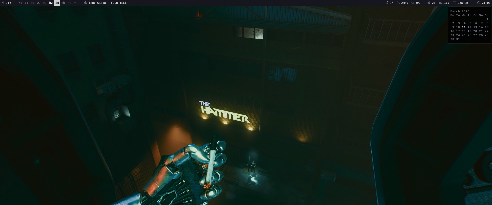
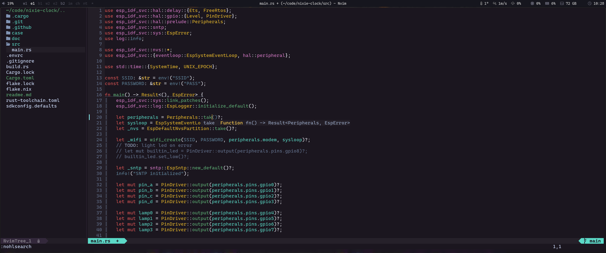

# Idempotent Desktop 

## Overview
* Multiple [hosts](https://github.com/ksevelyar/idempotent-desktop/tree/main/hosts), each containing multiple [users](https://github.com/ksevelyar/idempotent-desktop/tree/main/users)
* All hosts are connected with [WireGuard](https://github.com/ksevelyar/idempotent-server/blob/main/services/net/wireguard.nix) and RustDesk
* Build custom packages once and share them between all nodes with Cachix
* [Persistent USB](doc/persistent-usb.md) for quick setup and maintenance of workstations

## Linux as an IDE
* [Neovim with LSP and TS](https://github.com/ksevelyar/idempotent-desktop/blob/main/users/shared/nvim/init.lua) that automatically loads Nix flakes
* Tiling with [Hyprland](https://github.com/ksevelyar/idempotent-desktop/blob/main/users/ksevelyar/hk47/hypr/hyprland.conf)
* [Fish](doc/fish.md), direnv, alacritty, ripgrep, fd, fzf, [zoxide][zoxide], [delta][delta]
* [Pi](doc/pi.md), a terminal coding agent with plan mode
* Pixel color picker
* Screenshot and screen recording

## Security
* [Encrypted root with LUKS2](doc/encrypted-root.md)
* [Secrets with agenix and gopass](doc/secrets.md)
* browserpass and [uBlock](https://github.com/gorhill/uBlock)

## Chill
* [Wine, Steam, RetroArch](doc/games.md)
* mpv, swayimg, spotify

[delta]: https://github.com/dandavison/delta
[zoxide]: https://github.com/ajeetdsouza/zoxide
